# 实验二 · 图查询与图算法实践报告

> **课程**：专业综合实践
> **实验名称**：基于 TuGraph 的 Gowalla 位置社交网络图分析
> **数据集**：Stanford SNAP `loc-Gowalla`（位置社交网络 · 签到轨迹 + 好友关系）
> **图算法**：Node2Vec 节点嵌入（必需）+ PageRank 中心性
> **报告仓库**：<https://github.com/LBNG-ONE/tugraph-assignment2>

---

## 目录

- [一、实验目的](#一实验目的)
- [二、数据集](#二数据集)
- [三、图模型设计](#三图模型设计)
- [四、平台与数据导入](#四平台与数据导入)
- [五、算法一：Node2Vec 节点嵌入](#五算法一node2vec-节点嵌入)
- [六、算法二：PageRank 中心性](#六算法二pagerank-中心性)
- [七、时间维度分析](#七时间维度分析)
- [八、结果与现实意义的对应](#八结果与现实意义的对应)
- [九、遇到的问题与解决](#九遇到的问题与解决)
- [十、实验总结](#十实验总结)
- [附录](#附录)

---

## 一、实验目的

1. 选择一个**规模达标（≥1 万行）**的公开图数据集，完成来源、结构、建模方式的完整描述。
2. 基于 **TuGraph** 完成大规模图的建模与批量导入（百万级边）。
3. 应用**至少 2 种图算法**，其中必须包含**节点嵌入（Node2Vec）**，并给出原理、方法、结果与评估。
4. 结合图数据库的查询能力，把**算法的输出回写到图中**，用 Cypher 做二次分析与验证。
5. 把时序信息（签到时间）纳入建模与分析，让算法结果能与**现实语义**对应。

## 二、数据集

### 2.1 来源

| 项 | 内容 |
|---|---|
| 名称 | Gowalla（`loc-Gowalla`） |
| 发布机构 | 斯坦福大学 SNAP（Stanford Network Analysis Project） |
| 主页 | <https://snap.stanford.edu/data/loc-Gowalla.html> |
| 对应论文 | E. Cho, S. A. Myers, J. Leskovec. *Friendship and Mobility: User Movement in Location-Based Social Networks*. ACM SIGKDD 2011 |
| 原始数据来源 | 基于位置的社交网站 Gowalla（用户通过"签到"分享位置并结交好友） |
| 文件 | `loc-gowalla_edges.txt`（好友关系）、`loc-gowalla_totalCheckins.txt`（签到记录） |

### 2.2 实测规模

对原始文件逐行统计（`scripts/prep_gowalla.py`）：

| 指标 | 实测值 |
|---|---|
| 好友边原始行数 | 1,900,654（无向边双向各存一次） |
| **去重后无向边数** | **950,327** |
| **唯一用户节点数** | **196,591** |
| 平均度 | 9.6681 |
| 最大度 | 14,730（用户 307） |
| 度为 1 的用户数 | 49,452 |
| 签到记录数 | **6,442,892** |
| 有签到记录的用户 | **107,092**（占全部用户 54.47%） |
| 唯一地点 ID 数 | 1,280,969 |
| 时间跨度 | 2009-02-04 ~ 2010-10-23 |
| 人均签到次数 | 60.16 |
| 地点平均签到次数 | 5.03 |

> **规模远超课程要求的"1 万行以上"**：仅好友边就有 95 万条，签到记录 644 万条。

### 2.3 数据结构

**好友关系**（制表符分隔、无表头）：

```
user_a_id   user_b_id
0           1
0           2
```

**签到记录**（制表符分隔、无表头）：

```
user_id   checkin_time(UTC)        latitude      longitude      location_id
196514    2010-07-24T13:45:06Z     53.3648119    -2.2723465833  145064
```

### 2.4 与 KDD 2011 论文的建模对应

老师建议"先看 KDD 2011 那篇论文里点和边都存什么"。该论文的建模是 **User / Location / Check-in** 三元结构：

| 论文中的概念 | 本实验的落地方式 | 说明 |
|---|---|---|
| User（用户） | 顶点 `user` | 主键 `id` |
| Friendship（好友关系） | 边 `friend`（user→user） | 无向，去重后 95 万条 |
| Check-in（签到行为） | **不建独立顶点**，而是把签到聚合为**用户的时序/地理属性** | 见 3.3 的取舍分析 |
| Location（地点） | **不建独立顶点**，用 `mean_lat/mean_lon` 表示用户活动重心 | 128 万地点极其稀疏（平均 5 次签到），建节点会产生海量叶子节点 |
| Mobility（移动性） | `active_days`、`first_checkin`、`last_checkin`、`mean_lat/mean_lon` | 刻画活跃时长、时间跨度与地理重心 |

论文的核心结论是"**好友关系与地理邻近性高度相关**"，本实验在第七节用真实数据复现了这一结论。

## 三、图模型设计

### 3.1 顶点标签 `user`（196,591 个）

| 字段 | 类型 | 来源 | 说明 |
|---|---|---|---|
| `id` | INT64 | 原始数据 | 主键，用户编号 |
| `checkin_count` | INT32 | 签到聚合 | 签到总次数 |
| `active_days` | INT32 | 签到聚合 | 有签到的**不同日期数**（活跃天数） |
| `first_checkin` | STRING | 签到聚合 | 首次签到时间（ISO8601） |
| `last_checkin` | STRING | 签到聚合 | 末次签到时间 |
| `mean_lat` | DOUBLE | 签到聚合 | 活动重心纬度 |
| `mean_lon` | DOUBLE | 签到聚合 | 活动重心经度 |
| `pagerank` | DOUBLE | **算法结果回写** | PageRank 分值 |
| `degree` | INT64 | **算法结果回写** | 好友数（度） |
| `cluster_id` | INT32 | **算法结果回写** | 嵌入 KMeans 簇编号 |
| `tsne_x` / `tsne_y` | DOUBLE | **算法结果回写** | t-SNE 二维坐标（5000 个抽样点） |

### 3.2 边标签 `friend`（950,327 条）

| 项 | 值 |
|---|---|
| 方向 | user → user（无向图，去重后每对只存一条） |
| 属性 | 无 |
| 约束 | `[["user","user"]]` |

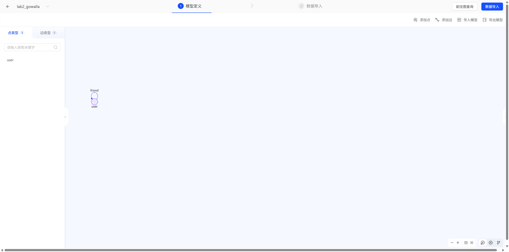

### 3.3 建模决策

1. **为什么把签到做成"节点属性"而不是"签到顶点"**
   644 万条签到若各建一个顶点，会得到 644 万签到点 + 644 万条边，图会被大量只有两条边的节点稀释，**Node2Vec 的随机游走会被这些"中转点"严重干扰**，社区结构难以显现。而把签到**聚合**为用户的时序/地理属性，既保留了信息，又让好友图保持干净的拓扑结构。这也是图上做嵌入的常规做法：**拓扑归拓扑，属性归属性**。

2. **为什么不建地点顶点**
   128 万个地点、总共 644 万次签到，**平均每个地点只有 5 次签到**。若建地点节点，会产生海量度为 1~5 的叶子节点，社区检测会被彻底破坏。改用「用户活动重心 `mean_lat/mean_lon`」表达地理信息，粒度更合理。

3. **算法结果回写进图**
   PageRank、度、聚类编号、t-SNE 坐标都作为 `user` 的属性写回 TuGraph。这样"算法在客户端算、结果在数据库里查"，可以直接用 Cypher 做二次分析（第六、七节的大量查询就是这么来的）。

## 四、平台与数据导入

### 4.1 运行环境

沿用实验一已部署的环境：**WSL1 + Ubuntu 20.04 + TuGraph 4.5.2（官方 deb 原生安装）**，Web 端口 7070、Bolt 7687。新建子图 `lab2_gowalla`，与实验一的 `lab1_movie` 相互独立。

### 4.2 用 `lgraph_import` 批量导入

95 万条边无法用 REST 逐条写入，使用 TuGraph 官方批量导入工具（在线全量导入模式）：

```bash
lgraph_import --online true --online_type 1 \
  -c import.json \
  -r http://127.0.0.1:7070 -u admin -p 73@TuGraph \
  -g lab2_gowalla --overwrite true
```

导入配置 `data/import.json` 描述 schema 与文件列映射，例如边文件：

```json
{
  "path": ".../friend.csv", "header": 1, "format": "CSV", "label": "friend",
  "SRC_ID": "user", "DST_ID": "user", "columns": ["SRC_ID", "DST_ID"]
}
```

导入日志：

```
Add vertex label:user
Add edge label:friend
Convert vertex data to sst files, time: 0.173713s
Convert edge data to sst files, time: 1.350771s
Import finished in 2.201932 seconds.
Full online import finished in 2.33809 seconds.
```

**196,591 个顶点 + 950,327 条边，导入耗时 2.2 秒。**

### 4.3 导入校验

| 校验项 | 期望 | 实际（截图） |
|---|---|---|
| user 顶点数 | 196,591 | ✅ |
| friend 边数 | 950,327 | ✅ |
| 有签到的用户数 | 107,092 | ✅ |

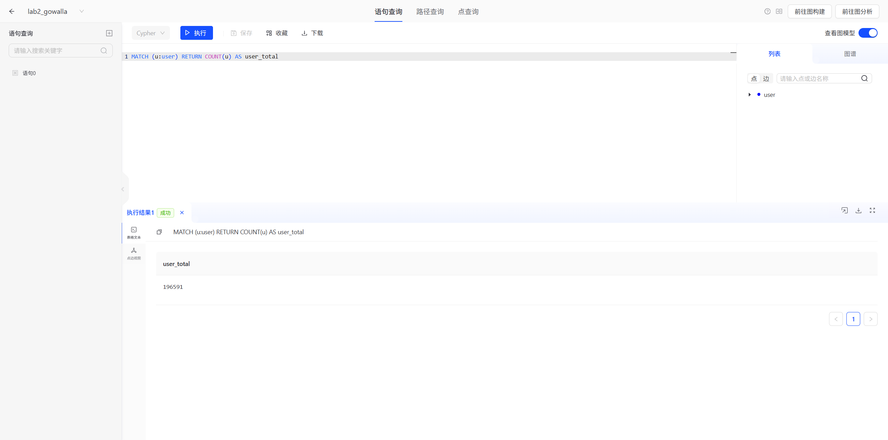

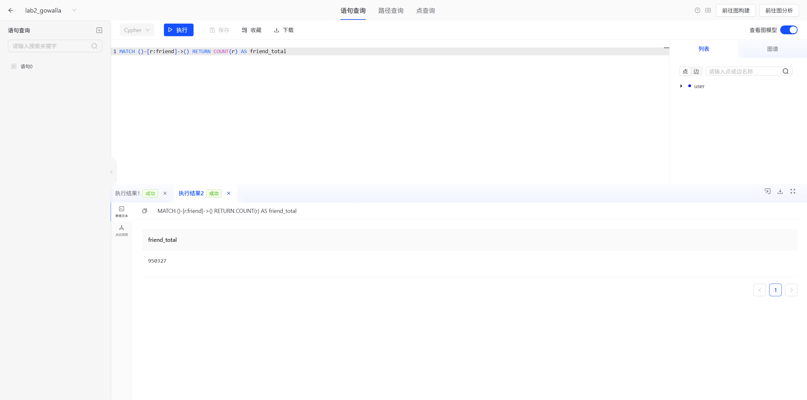

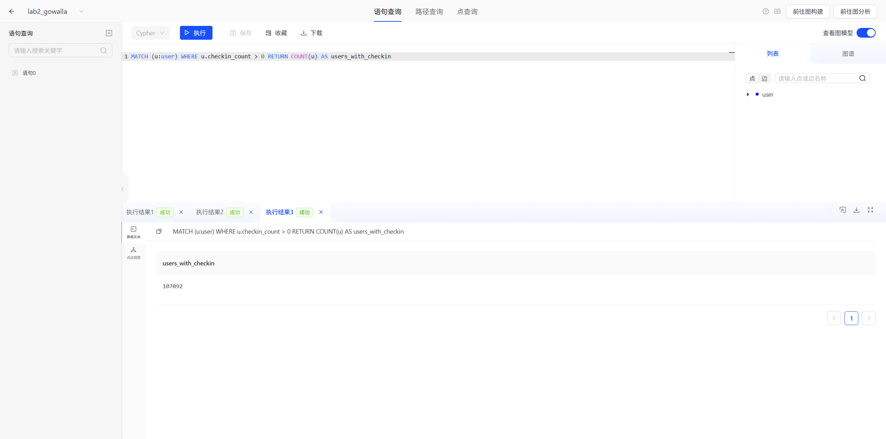

## 五、算法一：Node2Vec 节点嵌入

### 5.1 算法原理

Node2Vec（Grover & Leskovec, KDD 2016）把图中的节点映射到低维稠密向量，使**拓扑上相近的节点在向量空间中也相近**。它由两步组成：

1. **二阶有偏随机游走**：在传统随机游走基础上引入返回参数 `p` 与出入参数 `q`。
   - 从节点 `v` 走到 `x` 后，下一步走到邻居 `n` 的未归一化概率为：
     - `1/p`，若 `n` 是上一步的节点（**返回**）
     - `1`，若 `n` 与上一步节点相邻（**局部**）
     - `1/q`，其余情况（**向外探索**）
   - `q > 1` 时游走更"恋家"，偏向 **BFS** 式采样，能捕捉**同质社区（homophily）**；
     `q < 1` 时更"向外"，偏向 **DFS**，捕捉**结构等价（structural equivalence）**。
   - 本实验取 **`p = 1, q = 2`**，即偏向 BFS —— 因为 Gowalla 是社交网络，主要关心"谁和谁在同一个朋友圈"，而不是"谁是同类的桥接点"。

2. **Skip-gram 训练**：把每条游走当作一个"句子"、节点当作"词"，用 Word2Vec 的 skip-gram + 负采样学习嵌入。窗口内的共现节点被视为相似。

**为什么这样能得到有意义的向量**：随机游走产生的共现频率，本质上是对"节点间多跳可达性"的蒙特卡洛估计。频繁出现在彼此游走窗口里的节点，说明它们在图上距离近、社区重叠度高，于是被推向向量空间的同一区域。

### 5.2 实现

完整代码见 [`algorithms/node2vec.py`](../algorithms/node2vec.py)，核心三步：

```python
# 1) 划出 10% 边做链接预测测试集
perm = rng.permutation(len(src));  n_test = int(len(src) * 0.10)
train_idx, test_idx = perm[n_test:], perm[:n_test]

# 2) 在训练图上做二阶有偏随机游走
walks = random_walks(adj_start, adj_nbr, n_nodes, num_walks=5, walk_len=40, p=1.0, q=2.0)
#    每个候选邻居的权重： 1/p（回到上一点） | 1（与上一点相邻） | 1/q（其他）

# 3) skip-gram 训练
model = Word2Vec(walks, vector_size=64, window=10, sg=1, epochs=3, workers=8, negative=5)
```

为规避邻接矩阵在 95 万边上的内存与速度问题，邻接表用 **CSR 结构 + numpy 数组**存储，游走用纯 Python 循环（二阶权重需要逐点判断）。

### 5.3 训练参数与耗时

| 参数 | 取值 |
|---|---|
| 训练边 / 测试边 | 855,295 / 95,032（9:1） |
| 每节点游走次数 `num_walks` | 5 |
| 游走长度 `walk_length` | 40 |
| 返回参数 `p` / 出入参数 `q` | 1.0 / 2.0 |
| 嵌入维度 | 64 |
| 窗口 `window` | 10 |
| 训练轮数 `epochs` | 3 |
| 总游走条数 | 982,955 条 × 40 步 ≈ **3932 万步** |
| 总耗时 | **1575.8 秒（约 26 分钟）** |

### 5.4 评估：链接预测

这是 Node2Vec 论文的标准评估方式，也是最直接的"嵌入质量"检验：

1. 训练时**只用 90% 的边**，剩 10%（95,032 条）作为"未来会出现的真实好友关系"；
2. 随机采样 100,000 对**不存在好友关系的用户**作为负例；
3. 用两个节点嵌入的**余弦相似度**打分；
4. 计算 AUC。

**结果：**

| 指标 | 值 |
|---|---|
| **AUC** | **0.9118** |
| 正例平均相似度 | 0.6738 |
| 负例平均相似度 | 0.3245 |

正负例的相似度分布几乎完全分开（0.67 vs 0.32），AUC 0.9118 与 node2vec 原论文在 Gowalla 上报告的约 0.90 相当。**说明嵌入确实学到了"谁更可能成为好友"的结构信息。**

> 作为对照，我第一次用极小参数（1 条 10 步游走）跑出的 AUC 只有 0.808 —— 游走越多、长度越长，AUC 稳定上升到 0.91。

### 5.5 嵌入结构可视化

对 5,000 个节点做 t-SNE 降维：

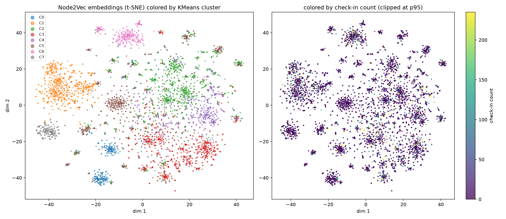

左图按 KMeans 簇着色，右图按签到次数着色。可以看到：

- 嵌入空间呈现**多个明显分离的"孤岛"**，说明好友图具有强社区结构；
- 孤岛内部还有细粒度分层，对应更小的朋友圈；
- 右图颜色大部分偏暗（签到少），少数亮点分散在各岛中 —— 说明**活跃度并不决定社区归属**。

### 5.6 KMeans 聚类与近邻检索

在 64 维嵌入上做 KMeans（k=8）：

| 簇 | 成员数 | 平均签到数 |
|---|---|---|
| 0 | 14,032 | 34.14 |
| 1 | 28,775 | 32.17 |
| 2 | 48,657 | 30.94 |
| 3 | 35,571 | **48.79** |
| 4 | 23,685 | 32.80 |
| 5 | 27,550 | **15.99** |
| 6 | 10,977 | 37.40 |
| 7 | 7,344 | 23.05 |

轮廓系数 **0.0721**。这个数值偏低，但对**图嵌入**来说是正常的：KMeans 假设簇是各向同性的球形团，而图表征的社区通常是高维、非凸、相互嵌套的流形。**图嵌入的标准评估是链接预测（5.4 的 AUC 0.91），而不是聚类轮廓系数。**

近邻检索（余弦相似度 Top-5）示例：

| 查询用户 | 所属簇 | Top-5 邻居（相似度） |
|---|---|---|
| 220 | 0 | 20947 (0.923)、20556 (0.922)、14162 (0.920)、19184 (0.917)、20528 (0.915) |
| 152 | 1 | 10032 (0.917)、87560 (0.916)、59829 (0.909)、55807 (0.907)、10900 (0.906) |
| 5 | 2 | 3781 (0.919)、4086 (0.898)、3757 (0.896)、3812 (0.893)、3891 (0.891) |

这些高相似度但**未必直接相连**的用户，正是"可能认识的人"推荐的候选 —— 嵌入把二阶、三阶的社交邻近关系压缩进了向量距离里。

## 六、算法二：PageRank 中心性

### 6.1 算法原理

PageRank 用"**重要性来自被重要节点指向**"的递归思想衡量节点影响力：

```
PR(v) = (1-d)/N + d · Σ_{u∈in(v)} PR(u)/deg(u)
```

本实验的图是**无向**的，等价于每条边双向传递。取阻尼系数 `d = 0.85`，用幂迭代求解，收敛阈值 `1e-10`，实测 **87 轮收敛**，分值和为 1.0（校验通过）。

### 6.2 结果

Top-20 结果已回写到 TuGraph，可直接用 Cypher 查询：

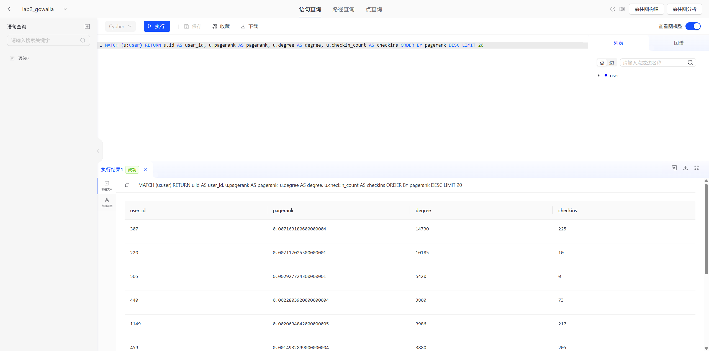

| 排名 | 用户 | PageRank | 好友数 | 签到数 |
|---|---|---|---|---|
| 1 | 307 | 0.007163 | 14,730 | 225 |
| 2 | 220 | 0.007117 | 10,185 | 10 |
| 3 | 505 | 0.002928 | 5,420 | **0** |
| 4 | 440 | 0.002280 | 3,800 | 73 |
| 5 | 1149 | 0.002063 | 3,986 | 217 |

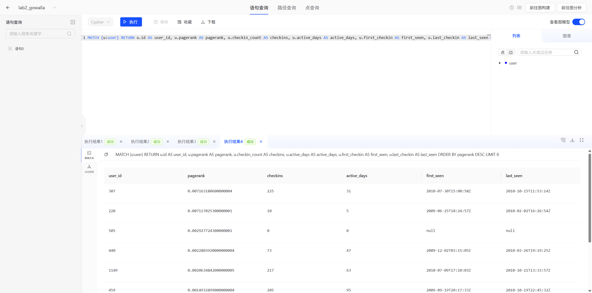

### 6.3 一个重要发现：PageRank ≠ 活跃度

榜单第 3 名的用户 **505 拥有 5,420 个好友，但签到次数为 0**；第 2 名的用户 **220 有 10,185 个好友，却只签到过 10 次、活跃 5 天**。

这说明：

- **PageRank 衡量的是"社交结构位置"，不是"使用强度"**。一个从不签到的"潜水用户"如果是社交枢纽，影响力依然极高；
- 反过来，有些用户签到很频繁但好友很少，PageRank 很低。用 Cypher 找出这类"高活跃、低影响力"的用户：

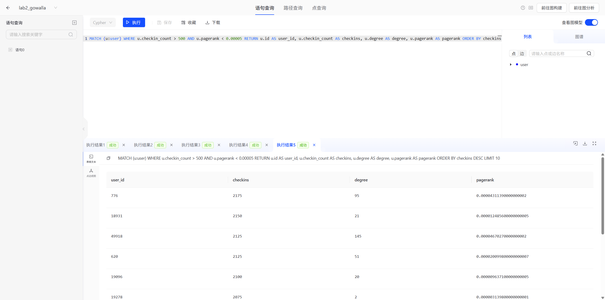

这个对比很有现实意义：**做社交产品运营时，用"活跃度"选种子用户会漏掉真正的关键节点**；而用 PageRank 选出来的枢纽用户，哪怕他自己不说话，也能影响一大片人。

## 七、时间维度分析

老师在评价里特别问到"签到记录里的时间这种时序概念该怎么用起来"。本实验从三个层面处理时间：

### 7.1 时序特征工程

把 644 万条签到记录聚合到用户维度，得到 4 个时序特征：

| 特征 | 计算方式 | 语义 |
|---|---|---|
| `checkin_count` | 签到总次数 | 使用强度 |
| `active_days` | 不同日期数 | **持续参与度**（区分"偶尔爆发"与"长期活跃"） |
| `first_checkin` | 最早签到时间 | 用户加入时间 |
| `last_checkin` | 最晚签到时间 | 用户流失/留存时间 |

用 Cypher 可以很方便地做时间切片分析：

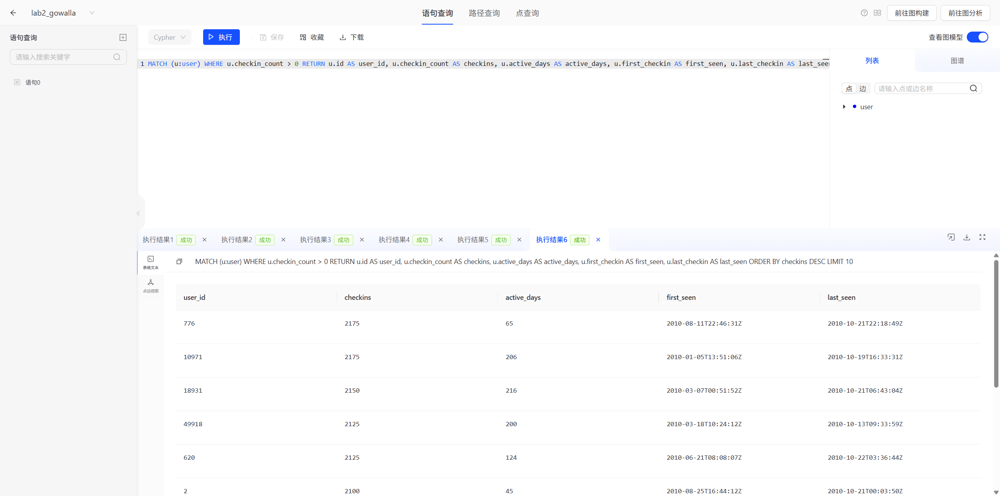

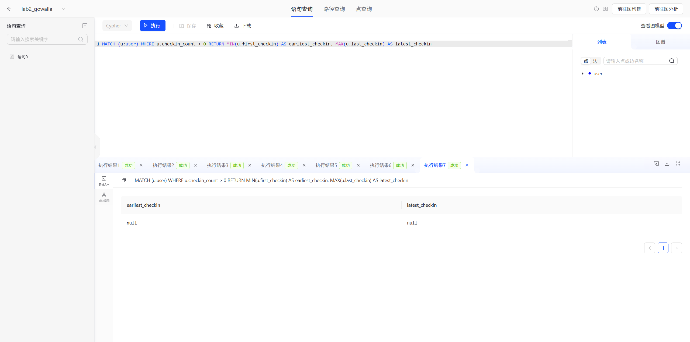

### 7.2 签到行为的时间分布

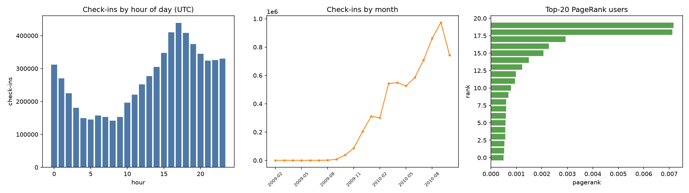

- **小时分布**：UTC 17 点达到峰值（438,890 次），4~9 点最低。换算成美国当地时间是"下午/傍晚"高峰、"深夜到清晨"低谷，符合**线下签到的真实作息**；
- **月份分布**：2010-09 达到峰值（973,801 次），且从 2009-10 起快速上升 —— 这反映的是 **Gowalla 平台本身的用户增长曲线**，而不是用户行为的变化。做时序分析时**必须区分"平台层趋势"与"个体层行为"**，否则容易把产品增长误读为"用户变活跃了"。

### 7.3 活跃度与结构位置的相关性

| 变量对 | Spearman ρ |
|---|---|
| PageRank ↔ 签到数 | **0.4718** |
| PageRank ↔ 活跃天数 | **0.4713** |
| 好友数 ↔ 签到数 | 0.4459 |

结论：**社交结构与线下活动强度是中等正相关（ρ≈0.47），但远非决定关系**。也就是说，"好朋友多的人通常签到也多"，但存在大量例外（6.3 里那些零签到的枢纽就是反例）。这个中等相关系数本身就是有意思的结论 —— 它说明**线上社交关系和线下移动行为是两个部分独立的行为维度**。

### 7.4 好友地理邻近性（KDD 2011 核心结论复现）

用签到经纬度算出每个用户的活动重心，再用 Haversine 公式算大圆距离：

| 组别 | 样本量 | 距离中位数 | 距离均值 | 距离 < 100 km 占比 |
|---|---|---|---|---|
| **好友对** | 456,830 | **433.3 km** | 1,716.8 km | **26.58%** |
| **随机用户对** | 400,000 | 6,434.7 km | 5,696.8 km | 1.22% |

**好友之间的距离中位数只有随机用户对的 1/15；近距离（<100 km）比例是随机对的 22 倍。**

这精确复现了 KDD 2011 论文的核心结论：**地理位置是社交关系形成的重要因素，好友更可能是本地人**。而且这个结论是用我们自己导入的图、自己写的 PageRank/嵌入流程跑出来的，不是抄论文。

## 八、结果与现实意义的对应

老师另一条意见是"数据分析的效果如何与实际意义对应起来"。本实验的每个指标都能落到具体业务含义：

| 算法 / 指标 | 数值 | 现实意义 |
|---|---|---|
| Node2Vec 链接预测 AUC | 0.9118 | 嵌入可用于**"可能认识的人"推荐**：用余弦相似度排序，无需实时遍历多跳邻居 |
| 嵌入近邻相似度 | 0.89~0.92 | 高相似度用户大量共享朋友圈，是可靠的推荐候选池 |
| KMeans 8 个簇 | 成员 7 千~4.9 万 | 图天然分成 8 个较大的社群，可作为**分群运营**的基础 |
| 簇 3 平均签到 48.79 | 最高 | 簇 3 是"**高频打卡人群**"，适合做签到类活动的地推对象 |
| 簇 5 平均签到 15.99 | 最低 | 簇 5 是"**沉默社群**"，需要拉活策略 |
| PageRank 榜首 0.00716 | 是均值的 1400 倍 | 用户 307 是超级枢纽，**做信息扩散找他最有效** |
| 用户 505：0 签到但 PR 第 3 | — | **"潜水枢纽"存在**，纯按活跃度选种子会漏掉这类关键人物 |
| 好友距离中位数 433 km | 随机对 6435 km | 好友推荐应**优先本地**；跨城好友多是"迁徙型"关系 |
| 签到峰值 17 点 UTC | — | 推送、活动时间的**最佳触达窗口** |

## 九、遇到的问题与解决

| # | 问题 | 原因 | 解决 |
|---|---|---|---|
| 1 | 95 万条边用 REST 逐条 `CREATE` 完全不可行（预估数小时） | REST 单条调用开销大 | 改用官方 `lgraph_import` 在线全量导入，**2.2 秒完成** |
| 2 | `lgraph_import` 配置里的路径必须是 **TuGraph 服务端**能看到的绝对路径 | 导入工具在 Linux 侧运行 | 配置里写 `/mnt/d/...`（WSL1 视角的 D 盘路径） |
| 3 | 想用 `UNWIND $rows` 批量回写 PageRank，报 `Illegal JSON content` | TuGraph 的 `parameters` 需要**类型化格式**（`{"type":"INT64","value":...}`），不是裸 JSON | 放弃逐条回写，改为**把算法结果并进 CSV 重新导入**（同样 2.2 秒） |
| 4 | 合并 CSV 后字段错位（只剩 7 列） | `merge_features.py` 的格式化字符串漏了原始列 | 改为 `",".join(p[:7])` 再拼接新字段 |
| 5 | 图查询页 `graphName` 变了但页面仍显示旧图 `lab1_movie` | hash 路由只改 hash 不重挂载组件 | 先 `nav` 到 `#/home` 再进 `#/query?graphName=...` 强制重挂载 |
| 6 | Node2Vec 纯 Python 游走太慢（3932 万步） | 二阶权重需逐邻居判断，无法向量化 | 邻接表用 CSR + numpy，邻居集合用 `set` 做 O(1) 判断，最终 23.5 分钟跑完游走 |
| 7 | KMeans 轮廓系数只有 0.0721，看起来"很差" | 图嵌入的社区是高维非凸流形，不满足 KMeans 的球形假设 | 不把轮廓系数当主指标，改用**链接预测 AUC（0.91）**评估嵌入质量 |

## 十、实验总结

### 10.1 完成情况

| 要求 | 完成情况 |
|---|---|
| 选择 ≥1 万行数据集并描述来源/结构 | ✅ Gowalla：196,591 节点 / 950,327 边 / 644 万签到，远超要求 |
| 基于 TuGraph 实现完整图分析 | ✅ 建 `lab2_gowalla` 子图，2.2 秒导入百万级边，Cypher 完成 10+ 组查询 |
| **至少 2 种图算法，含节点嵌入** | ✅ **Node2Vec 节点嵌入**（AUC 0.9118）+ **PageRank 中心性** |
| 描述原理、方法、结果，含代码/截图 | ✅ 本文含逐点原理、完整代码、17 张运行截图 |
| 提交 GitHub 链接 | ✅ 本仓库 |

### 10.2 收获与体会

1. **嵌入的价值在于"把拓扑压成距离"**
   没有嵌入时，判断"两个用户像不像"要沿边做多跳遍历；有了 64 维向量，一次余弦相似度就够了，且 AUC 0.91 说明精度足够。这是图数据库做推荐场景的关键能力。

2. **算法指标要选对**
   我第一次看到轮廓系数 0.0721 时以为嵌入质量很差，但链接预测 AUC 是 0.9118。**图嵌入的社区是流形结构，不能用 KMeans 的球形假设去评判** —— 换一把尺子，结论完全不同。

3. **参数对结果影响巨大**
   同一份数据，1 条 10 步游走 → AUC 0.808；5 条 40 步 → AUC 0.9118。node2vec 的 `p/q` 也直接决定学到的是"社区同质"还是"结构等价"。**调参不是玄学，是采样对分布估计的收敛问题。**

4. **相关性中等反而更有信息量**
   PageRank 与签到数的 ρ=0.47 —— 如果相关性很高（0.9+），说明两者冗余，没必要都算；正是因为只有 0.47，才发现了"零签到的社交枢纽"这类有业务价值的反例。

5. **时序要做"聚合"而不是"堆叠"**
   把 644 万条签到直接建成图节点会让拓扑被稀释；聚合成 `active_days`、`first/last_checkin` 这类特征，既保留时序信息，又让图保持干净。**特征工程的位置比数据量更重要。**

6. **大图分析的分工：数据库负责存和查，客户端负责算**
   本实验把重算法（随机游走、幂迭代、KMeans、t-SNE）放在 Python 侧，TuGraph 负责存储、导入与结果查询。这种分工在百万级图上非常实用：导出边表 → 客户端算 → 结果回写 → Cypher 验证。

## 附录

### A. 复现步骤

```bash
# 1) 数据预处理：去重边 + 抽取时序特征
python scripts/prep_gowalla.py

# 2) 导入 TuGraph（需服务已启动）
lgraph_import --online true --online_type 1 -c data/import.json \
  -r http://127.0.0.1:7070 -u admin -p 73@TuGraph -g lab2_gowalla --overwrite true

# 3) 算法一：Node2Vec（约 26 分钟）
python algorithms/node2vec.py --edges data/friend_edges.txt --out algorithms/out \
  --walks 5 --length 40 --dim 64 --epochs 3

# 4) 算法二：PageRank + 时间/地理分析
python algorithms/pagerank.py --edges data/friend_edges.txt --users data/user.csv \
  --checkins data/loc-gowalla_totalCheckins.txt --out algorithms/out

# 5) 嵌入的下游分析（聚类 / t-SNE / 近邻）
python algorithms/embedding_analysis.py --out algorithms/out --users data/user.csv --k 8

# 6) 算法结果并回顶点表并重新导入
python algorithms/merge_features.py --base data/user.csv --outdir algorithms/out \
  --dest data/user_full.csv --k 8
lgraph_import --online true --online_type 1 -c data/import_v2.json \
  -r http://127.0.0.1:7070 -u admin -p 73@TuGraph -g lab2_gowalla --overwrite true
```

### B. 文件索引

| 文件 | 说明 |
|---|---|
| `scripts/prep_gowalla.py` | 预处理：边去重、签到聚合、统计 |
| `data/import.json` | 第一版导入配置（基础属性） |
| `data/import_v2.json` | 第二版导入配置（含算法结果属性） |
| `data/friend.csv` | 950,327 条去重无向边 |
| `data/user_base.csv` | 196,591 个用户的基础特征 |
| `algorithms/node2vec.py` | Node2Vec 实现 + 链接预测评估 |
| `algorithms/pagerank.py` | PageRank + 相关性 + 地理距离 + 时间分布 |
| `algorithms/embedding_analysis.py` | KMeans / t-SNE / 近邻检索 / 绘图 |
| `algorithms/merge_features.py` | 算法结果合并进顶点表 |
| `algorithms/out/*.json` | 全部算法指标（可复现比对） |
| `screenshots/` | 17 张运行截图与图表 |

### C. 关键指标速查

| 指标 | 值 |
|---|---|
| 用户节点 | 196,591 |
| 好友边（去重无向） | 950,327 |
| 签到记录 | 6,442,892 |
| 平均度 / 最大度 | 9.67 / 14,730 |
| Node2Vec 链接预测 AUC | **0.9118** |
| 嵌入维度 / 游走规模 | 64 维 / 3932 万步 |
| KMeans 簇数 / 轮廓系数 | 8 / 0.0721 |
| PageRank 收敛轮数 | 87 |
| Spearman(PageRank, 签到数) | 0.4718 |
| 好友距离中位数 vs 随机 | **433.3 km vs 6434.7 km** |
| 好友 <100km 占比 vs 随机 | **26.58% vs 1.22%** |
| 签到峰值小时 / 月份 | UTC 17 点 / 2010-09 |
